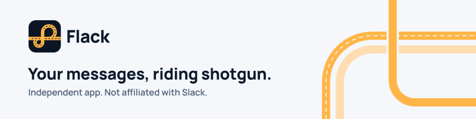
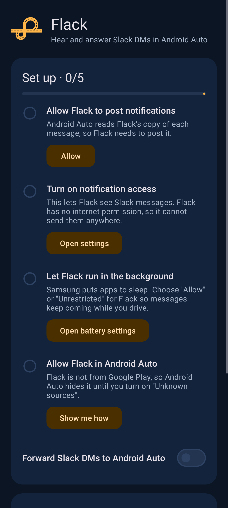
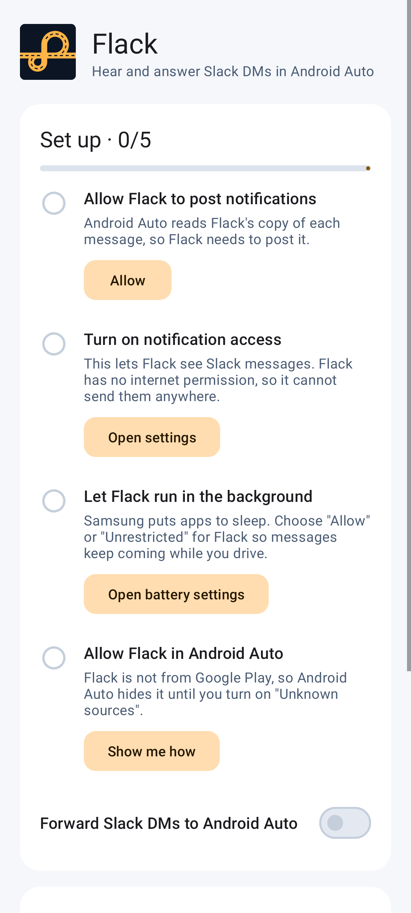

<picture>
  <source media="(prefers-color-scheme: dark)" srcset="brand/readme-banner.svg">
  
</picture>

[](https://github.com/jamditis/flack/actions/workflows/ci.yml)
[](https://github.com/jamditis/flack/releases/latest)
[](LICENSE)

Flack lets you hear Slack direct messages in Android Auto and answer them by voice. It copies a new Slack DM into the format Android Auto reads aloud. When you dictate and confirm a reply, Flack hands your words to the Slack app's own reply button, once.

**Status:** an experiment build for one-to-one DMs. It has not been tested in a car yet. See the [device test record](docs/DEVICE_TEST_RECORD.md) for what has been checked.

## Download

On your Android phone, open **[flack.apk](https://github.com/jamditis/flack/releases/latest/download/flack.apk)**. This link always gets the newest release. Then follow the [install steps](docs/INSTALL.md), or use the [download page](https://jamditis.github.io/flack/).

Flack is not on Google Play. You install it yourself, and you turn on Android Auto's "Unknown sources" developer setting so it shows Flack's messages.

<p>
  
  
</p>

## How it works

1. Flack reads notifications from the official Slack app only. It ignores every other app before reading anything.
2. For a direct message with an inline reply, and only while Android Auto is connected, it posts a copy that Android Auto can read aloud and reply to.
3. When you confirm a reply in the car, Flack checks a one-time token and passes your text to Slack's reply action. Slack sends the message.

If Flack cannot tell where a reply would go, it does not offer one. Group DMs, channels and threads are off until each one is tested on a real phone.

## Privacy

- No internet permission. Flack cannot send anything anywhere.
- No Slack login or token. The Slack app does the sending.
- Message text stays in memory and is never saved, backed up or logged.
- The only permission is posting notifications. CI fails any build that asks for more.

The full [privacy page](https://jamditis.github.io/flack/privacy.html) covers what Flack reads, keeps and sends.

## Supported phones

The intended test phones are a Samsung Galaxy S24 Ultra and a Samsung Galaxy S21. Neither has been tested yet; results and exact versions go in the [device test record](docs/DEVICE_TEST_RECORD.md). Flack needs Android 12 or later.

## Documentation

- [Install and test steps](docs/INSTALL.md)
- [Specification](SPEC.md) and [project rules](AGENTS.md)
- [Test plan](docs/TEST_PLAN.md) and [device test record](docs/DEVICE_TEST_RECORD.md)
- [Roadmap](docs/ROADMAP.md)
- [Brand guide](docs/BRAND.md), [design rules](docs/DESIGN_RULES.md) and [writing rules](docs/WRITING_RULES.md)
- [Releasing](docs/RELEASING.md) and [changelog](CHANGELOG.md)
- [Contributing](CONTRIBUTING.md) and [security policy](SECURITY.md)

## Build

```bash
./gradlew testDebugUnitTest lintDebug assembleDebug
```

Needs JDK 21 and the Android SDK. See [CONTRIBUTING.md](CONTRIBUTING.md) for the full checks.

## License

Apache-2.0 for original work. See [LICENSE](LICENSE) and [NOTICE](NOTICE). The Manrope font in `site/fonts/` is under the SIL Open Font License.

Flack is an independent project. It is not made by, affiliated with or endorsed by Slack, Google or Samsung.
